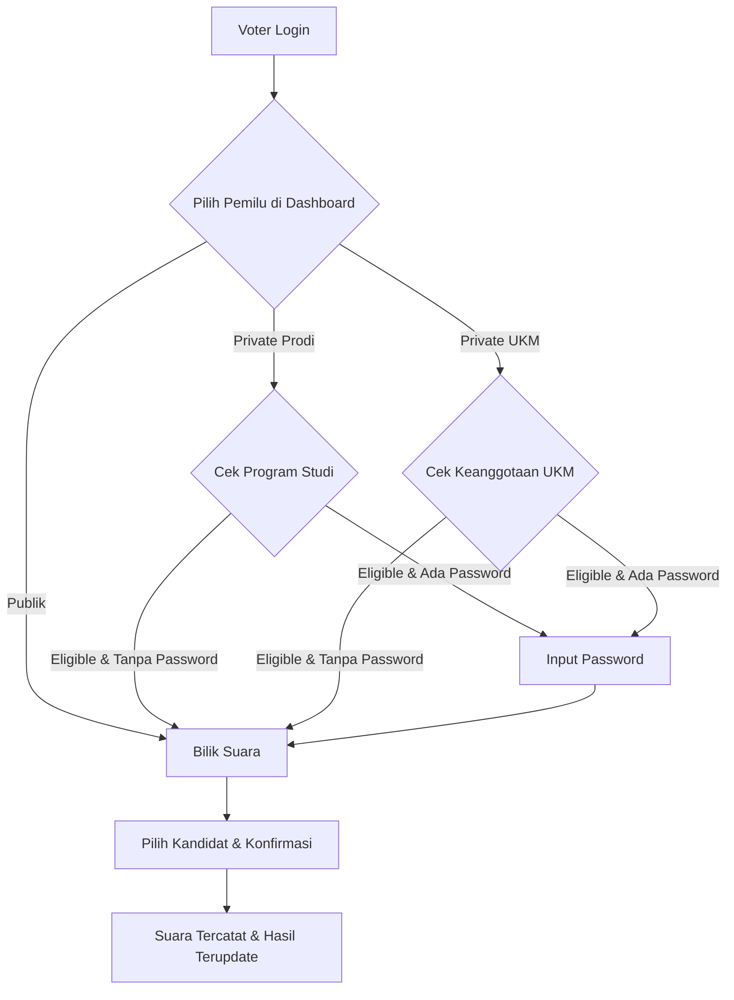

# RuangSuara - Sistem Pemilihan Umum Mahasiswa
### Komisi Pemilihan Umum Mahasiswa (KPUM)
**Universitas Bina Sarana Informatika (UBSI) Kampus Kota Sukabumi**

---

## 📌 Tentang Proyek

**RuangSuara** adalah platform pemungutan suara elektronik berbasis web yang dikembangkan khusus untuk memfasilitasi pelaksanaan Pemilihan Umum Mahasiswa di lingkungan **Universitas Bina Sarana Informatika (UBSI) Kampus Kota Sukabumi**. 

Sistem ini dikelola secara terpusat oleh **KPUM (Komisi Pemilihan Umum Mahasiswa)** sebagai penyelenggara resmi, menggantikan metode konvensional dengan sistem digital yang transparan, akuntabel, cepat, dan mudah diakses oleh seluruh civitas akademika.

---

## 🚀 Fitur Utama

### 1. Sentralisasi Pengelolaan KPUM
- Seluruh jalannya pemilu dikelola satu pintu oleh Administrator KPUM.
- Kemudahan dalam pembuatan event pemilihan, monitoring jalannya voting, hingga penetapan rekapitulasi akhir.

### 2. Struktur Akademik Terpadu
- **Program Studi (Prodi)**: Manajemen Program Studi aktif di UBSI Sukabumi (misal: *Sistem Informasi S1*, *Sistem Informasi D3*, *Ilmu Komputer S1*).
- **Kelas Terkoneksi**: Setiap kelas terhubung langsung ke Program Studi masing-masing.
- **Data Pemilih (DPT)**: Mahasiswa terdaftar otomatis terhubung ke prodi dan kelasnya.

### 3. Manajemen Role Dinamis (CRUD Roles)
- Fleksibilitas dalam mendefinisikan role pengguna (`Admin KPUM`, `Mahasiswa`, `Dosen`, `Staf`, dsb).
- Konfigurasi hak suara (*can vote*) dan kewajiban kelas (*has class*) pada tiap role.

### 4. Tiga Cakupan Pemilihan Fleksibel (*Multi-Scope Election*)
Sistem mendukung 3 jenis cakupan akses pemilihan:
- **Publik**: Terbuka untuk seluruh pemilih civitas akademika yang aktif di sistem.
- **Private Prodi**: Terbatas hanya untuk mahasiswa dari Program Studi tertentu (dapat memilih satu atau beberapa prodi sekaligus).
- **Private UKM**: Terbatas hanya untuk mahasiswa yang terdaftar resmi sebagai anggota Unit Kegiatan Mahasiswa (UKM) penyelenggara.
- **Password Opsional**: Pada pemilu private, password bersifat opsional. Jika dikosongkan, mahasiswa yang berhak (berdasarkan Prodi atau UKM) dapat langsung mengakses bilik suara tanpa verifikasi password tambahan.

### 5. Kelola Unit Kegiatan Mahasiswa (UKM) & Anggota
- Master data UKM kampus (kode, nama, dan deskripsi).
- **Import Anggota via Excel**: Upload spreadsheet berformat `.xlsx`/`.xls`/`.csv` hanya dengan 1 kolom berisi NIM mahasiswa.
- **Input Anggota Manual via AJAX**: Tambah anggota secara langsung per NIM tanpa reload halaman, menjaga modal tetap terbuka untuk input beruntun yang cepat.

### 6. Bilik Suara & Surat Suara Digital
- Tampilan surat suara digital interaktif dengan nomor urut kandidat, foto, dan tombol modal Visi & Misi.
- Konfirmasi pemilihan ganda untuk mencegah salah klik.
- Setiap pemilih hanya memiliki satu hak suara yang tervalidasi secara otomatis oleh sistem.

### 7. Hasil Suara Real-Time & Rekapitulasi
- Visualisasi diagram perolehan suara secara real-time (*Live Pie Chart* berbasis Chart.js).
- Sinkronisasi partisipan / total DPT secara dinamis sesuai cakupan pemilu.
- Fitur ekspor berita acara & rekapitulasi hasil suara resmi dalam format PDF.

### 8. Import & Export Data Massal
- Import data pengguna dan kelas dari file Excel.
- Export data akun pemilih terdaftar ke format PDF dan Excel.
- Zona Pengaturan (*Danger Zone*) untuk reset data secara aman bagi administrator.

---

## 🛠️ Tech Stack & Arsitektur

- **Backend**: Laravel 10 (PHP 8.2+)
- **Database**: MySQL 8.2 & Redis Cache
- **Frontend**: Blade Templating, SB Admin 2, Vanilla CSS, Bootstrap 4
- **Iconography & UI Assets**: FontAwesome Pro, SweetAlert2
- **Data & Chart Components**: DataTables Server-Side, Chart.js
- **Containerization**: Docker & Docker Compose

### Arsitektur Alur Pemilihan:



---

## 💻 Panduan Instalasi & Menjalankan

### Metode A: Menggunakan Docker Compose (Disarankan)

Proyek ini telah dilengkapi konfigurasi Docker untuk lingkungan lokal:

1. **Clone repository:**
   ```bash
   git clone https://github.com/NaraMizaru/evoting-2.0.git
   cd evoting-2.0
   ```

2. **Siapkan konfigurasi `.env`:**
   ```bash
   cp .env.example .env
   ```

3. **Jalankan container menggunakan Makefile / Docker Compose:**
   ```bash
   make serve
   # atau
   docker compose -f docker-compose.local.yaml up -d
   ```

4. **Jalankan migrasi database dan seeder di dalam container:**
   ```bash
   make shell
   # Di dalam container shell:
   php artisan key:generate
   php artisan migrate:fresh --seed
   exit
   ```

5. **Akses aplikasi:**
   Buka browser dan kunjungi `http://localhost:8000`.

---

### Metode B: Menggunakan Web Server Lokal (Native PHP & Composer)

1. Pastikan Anda telah memasang **PHP >= 8.2**, **Composer**, dan **MySQL**.
2. Setup environment dan dependensi:
   ```bash
   composer install
   cp .env.example .env
   php artisan key:generate
   ```
3. Sesuaikan kredensial koneksi database pada file `.env`.
4. Jalankan database migration & seeder:
   ```bash
   php artisan migrate:fresh --seed
   php artisan storage:link
   ```
5. Jalankan server lokal:
   ```bash
   php artisan serve
   ```

---

## 🔑 Akun Default Pengujian

Setelah menjalankan seeder (`DatabaseSeeder`), akun default berikut dapat digunakan untuk login:

| Role | Username / NIM | Password | Keterangan |
| :--- | :--- | :--- | :--- |
| **Admin KPUM** | `admin` | `admin` | Akses penuh dashboard administrasi KPUM |

*Catatan: Akun mahasiswa pemilih dapat ditambahkan melalui menu **Kelola Pengguna** atau diimport melalui file Excel.*

---

## 🧪 Menjalankan Automated Test

Sistem ini dilengkapi dengan Automated Feature & Unit Test (PHPUnit):

```bash
docker compose -f docker-compose.local.yaml -p local-evoting exec -T web php artisan test
```

---

## 👥 Tim Penyelenggara & Pengembang

Halaman Hak Cipta & Tim Teknis dapat diakses melalui menu footer sistem atau langsung pada route `/copyright`.

- **Ketua Divisi Teknis Penyelenggara**:
  - **Raffi Ahmad** — [*@_rapinha*](https://www.instagram.com/_rapinha/) | [GitHub](https://github.com/raphinha-amd) | [Website](https://raphinha-amd.github.io/)
- **Bantuan Teknis (Tim Pengembang Sistem)**:
  - **Muhamad Hilal** — [*@md.hilallsluvyaa*](https://www.instagram.com/md.hilallsluvyaa) | [GitHub](https://github.com/NaraMizaru) | [Website](https://naramizaru.github.io)
  - **Farhan Dika Alsani** — [*@farahanaya_*](https://www.instagram.com/farahanaya_) | [GitHub](https://github.com/uiahan) | [Website](https://uiahan.github.io/kkanva-portofolio)

---

## 📄 Hak Cipta & Lisensi

Hak Cipta &copy; 2026 **KPUM Universitas Bina Sarana Informatika (UBSI) Kampus Kota Sukabumi**.  
Seluruh hak cipta dilindungi undang-undang.
